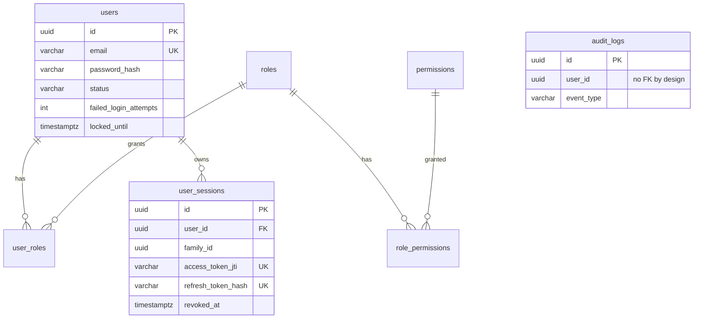

# Pay Auth Service

Spring Boot 3.3 / Java 21 authentication service. It provides:

- **OAuth2 resource server.** Access tokens are RS256 JWTs. A JWKS endpoint lets other services validate them.
- **RBAC.** `USER` and `ADMIN` roles, each backed by fine-grained permissions.
- **Signup and login.** Public signup always produces `ROLE_USER`. The first admin is bootstrapped from environment variables.
- **Real logout.** Tokens are revocable server-side, per session or for all of a user's sessions.
- **Refresh rotation.** Refresh tokens rotate on every use, with reuse detection.
- **End-to-end encryption.** Request and response payloads use hybrid RSA-OAEP-256 + AES-256-GCM, with per-request keys and replay protection.
- **Virtual threads.** Used deliberately, with bounded CPU-heavy work and connection-pool discipline.

---

## Package structure

```
com.pay.auth
├── config/                 Async (virtual threads), scheduling, JPA auditing, clock, MVC, admin bootstrap
│   └── properties/         Typed, validated @ConfigurationProperties records
├── constant/               ApiPaths, SecurityConstants
│   └── enums/              RoleName, PermissionName, UserStatus, ErrorCode, AuditEventType, RevocationReason, KeyPurpose
├── controller/             Thin HTTP adapters (Auth, User, Admin, Crypto, JWKS)
├── dao/                    Spring Data repositories (atomic bulk updates, row locks, entity graphs)
├── dto/
│   ├── req/                Validated request records (no role field → no privilege escalation)
│   ├── res/                Response records + uniform ApiResponse envelope
│   └── common/             EncryptedEnvelope (wire format)
├── entity/                 Rich domain entities (no public setters, no @Data/@ToString)
├── event/                  AuthAuditEvent + async listener (Observer)
├── exception/              Domain exceptions + GlobalExceptionHandler
├── mapper/                 Entity → DTO (entities never leave the service layer)
├── model/                  Internal value objects (ClientContext, IssuedTokens, …)
├── security/               SecurityConfig, BoundedPasswordEncoder
│   ├── jwt/                Encoder/decoder, active-session validator
│   ├── e2e/                @E2EEncrypted, key resolver, interceptor, request/response body advice, nonce store
│   ├── key/                KeyProvider strategy (PKCS#12 keystore | ephemeral dev keys)
│   ├── handler/            JSON 401/403 writers
│   └── filter/             Correlation-id filter
├── service/                Interfaces (AuthService, SessionService, TokenService, CryptoService, …)
│   └── impl/               Implementations
└── util/                   CryptoUtil, HashUtil, MaskingUtil, RequestUtil, SecurityUtil, MdcTaskDecorator
```

## Data model



Each relationship was chosen for a reason:

- **users ↔ roles is many-to-many.** A user can hold several roles, and a role is shared by many users.
- **roles ↔ permissions is many-to-many.** This lets you use `hasAuthority('USER_MANAGE')` without minting a new role for every capability.
- **user_sessions → users is a unidirectional `@ManyToOne`.** There is deliberately no `User.sessions` collection, so loading a user never drags in its whole session history.
- **audit_logs has no foreign key.** Audit evidence must survive account deletion and must never block it.
- **Lazy loading everywhere.** Login uses an entity graph, so roles and permissions come back in one query. Paged lists use `default_batch_fetch_size`, which avoids Hibernate's in-memory pagination with collection fetches.

## Security design

### Tokens

- **Access token:** a 15-minute RS256 JWT. Its claims are `sub` (an opaque UUID), `jti`, `iss`, `aud`, `authorities`. It contains **no PII**, because JWTs are only signed and anyone holding one can read it.
- **Refresh token:** a 256-bit random value, stored only as a SHA-256 hash. It is rotated on every refresh. If an already-rotated token is presented again, the whole token family is revoked (OAuth 2.0 Security BCP).
- **Logout:** each JWT's `jti` maps to a `user_sessions` row. `ActiveSessionTokenValidator` rejects tokens whose session has been revoked, even before they expire.
- **Role and status changes:** any change revokes the target user's sessions, so stale authorities stop working immediately.

### Credentials

- Passwords are hashed with BCrypt (strength 12), behind a `DelegatingPasswordEncoder` so the algorithm can be migrated later.
- **No user enumeration.** Unknown email and wrong password give the same response and take the same time, because an unknown email is checked against a dummy hash.
  - Account-locked or inactive status is only revealed once the correct password is supplied.
- **Brute-force lockout:** 5 failed attempts lock the account for 15 minutes. The failure counter is updated atomically in its own `REQUIRES_NEW` transaction.

### End-to-end payload encryption (`@E2EEncrypted`)

```
Client                                         Server
  GET /api/v1/crypto/public-key  ───────────▶  { keyId, RSA-OAEP-256, A256GCM, spki }
  K = random AES-256
  X-E2E-Key:       RSA-OAEP(K)
  X-E2E-Key-Id:    keyId
  X-E2E-Timestamp: epoch ms        (±2 min window)
  X-E2E-Nonce:     random 128-bit  (single use)
  body: {iv, data = AES-GCM(K, json, AAD="METHOD|PATH|TS|NONCE")} ──▶ interceptor unwraps K,
                                                                       advice decrypts → @Valid → controller
  ◀── X-E2E-Encrypted: true, {iv, data = AES-GCM(K, json, AAD="RESP|METHOD|PATH|NONCE")}
```

Properties of this scheme:

- **Binding to the call.** The AAD binds each ciphertext to its method, path and nonce, so a captured login body cannot be replayed against another endpoint. Responses are cryptographically tied to the request that produced them.
- **Errors are encrypted too.** Error responses are encrypted whenever a key was established.
- **No oracle.** Every decryption failure returns the same generic code, so attackers learn nothing about padding or authentication tags.
- **Key separation.** The JWT signing key and the payload encryption key are different key pairs.
- **Working client.** A reference WebCrypto implementation is in `docs/e2e-client-example.js`.

This is application-layer encryption **on top of TLS, not a replacement for it**. It protects payloads against TLS-terminating proxies, gateway and APM logs, and compromised intermediaries.

### Sensitive-data hygiene

- **DTOs only.** Entities never leave the service layer. Strict JSON (`fail-on-unknown-properties`) blocks mass assignment.
- **No secrets in logs.** DTO and model `toString()` methods mask passwords and tokens. Emails are masked in logs and the audit trail.
- **Generic errors.** Error bodies contain a code, a generic message and a correlation id, never stack traces or exception text. Spring's own error details are disabled.
- **Hardened headers.** The service sets HSTS, `CSP default-src 'none'`, `frame-ancestors 'none'`, `no-referrer`, and no-cache.

## Virtual threads: where and why

| Decision | Reason |
|---|---|
| `spring.threads.virtual.enabled=true` | Tomcat runs one virtual thread per request. Auth is I/O-bound (DB lookups), so threads park cheaply. |
| Hikari pool capped at 20, 3 s timeout | Virtual threads remove the thread limit, so **the pool becomes the real limiter**. A short timeout fails fast instead of queueing forever. |
| BCrypt outside transactions (`TransactionTemplate`) | A ~250 ms CPU-bound hash must not hold a pooled connection. |
| `BoundedPasswordEncoder` (fair semaphore = CPU cores) | BCrypt is CPU-bound. A login flood would otherwise saturate every carrier thread. Excess load is shed with a 503 and `Retry-After`. |
| Audit events on a virtual-thread executor with a concurrency limit | Fire-and-forget I/O off the login path. The limit gives back-pressure, and MDC is propagated. |
| No `synchronized` in hot paths | Avoids pinning carrier threads on Java 21. Uses `ConcurrentHashMap`, `Semaphore` and DB atomic updates. (JDK 24's JEP 491 removes this concern.) |
| Virtual threads never pooled | `SimpleAsyncTaskExecutor` with `setVirtualThreads(true)`, never a fixed pool. |

## Design patterns and SOLID

The code applies these patterns:

- **Strategy:** `KeyProvider` (keystore vs ephemeral) and `NonceStore` (in-memory vs Redis).
- **Decorator:** `BoundedPasswordEncoder` wraps `DelegatingPasswordEncoder`, which wraps BCrypt.
- **Facade:** `AuthService` sits over sessions, tokens, lockout and audit.
- **Observer:** `AuthAuditEvent` is published to `AuditEventListener`.
- **Factory methods:** `User.register`, `UserSession.open`, `E2EException.required()`.
- **Chain of Responsibility:** the security filter chain and the token validator chain.
- **Template:** `TransactionTemplate`.

SOLID shows up as follows:

- **Single responsibility.** Token minting (`TokenService`), session state (`SessionService`) and orchestration (`AuthService`) are separate.
- **Interface segregation.** `UserProfileService` and `UserAdministrationService` are separate interfaces.
- **Dependency inversion.** Controllers and services depend only on interfaces.

## Running locally

Start Postgres, then run the service with the `dev` profile:

```bash
export DB_PASSWORD=change-me
docker compose up -d
export ADMIN_BOOTSTRAP_PASSWORD='a-long-admin-password-here'   # ≥16 chars
mvn spring-boot:run -Dspring-boot.run.profiles=dev              # dev = ephemeral keys
```

The `dev` profile uses ephemeral keys, so all tokens become invalid on restart.

For production, generate a real keystore and point the service at it:

```bash
./scripts/generate-keys.sh /run/secrets/auth-keys.p12
export KEYSTORE_LOCATION=file:/run/secrets/auth-keys.p12 KEYSTORE_PASSWORD=...
```

## Endpoints

| Method | Path | Auth | E2E |
|---|---|---|---|
| GET | `/api/v1/crypto/public-key` | public | no |
| GET | `/oauth2/jwks` | public | no |
| POST | `/api/v1/auth/signup` | public | yes |
| POST | `/api/v1/auth/login` | public | yes |
| POST | `/api/v1/auth/refresh` | public | yes |
| POST | `/api/v1/auth/logout` | bearer | yes |
| POST | `/api/v1/auth/logout-all` | bearer | yes |
| GET | `/api/v1/users/me` | `PROFILE_READ` | yes |
| GET | `/api/v1/admin/users?page&size` | `ADMIN` + `USER_READ` | yes |
| GET | `/api/v1/admin/users/{id}` | `ADMIN` + `USER_READ` | yes |
| PATCH | `/api/v1/admin/users/{id}/status` | `ADMIN` + `USER_MANAGE` | yes |
| POST | `/api/v1/admin/users/{id}/roles` | `ADMIN` + `ROLE_MANAGE` | yes |
| DELETE | `/api/v1/admin/users/{id}/roles/{role}` | `ADMIN` + `ROLE_MANAGE` | yes |

## Before going to production

The service is complete as it stands. These items depend on your infrastructure:

1. **Multi-node deployments.** Replace `InMemoryNonceStore` with a Redis `SET NX PX` implementation, and put a short-TTL cache in front of `isAccessTokenActive`.
2. **Guaranteed audit delivery.** Move audit writes to a transactional outbox if regulators need that guarantee. Also revoke `UPDATE`/`DELETE` on `audit_logs` for the application's DB role.
3. **Key custody.** Move key material to an HSM or cloud KMS by writing a new `KeyProvider`. Plan key rotation by publishing two JWKs during overlap.
4. **Rate limiting.** Apply per-IP and per-account rate limiting at the API gateway.
5. **Signup hardening.** Add email verification before activation, which also removes the registration-conflict signal. Add MFA (TOTP or OTP) for admins.
6. **Session cleanup.** Run a scheduled purge of `user_sessions` rows whose `expires_at` is older than your retention period.
