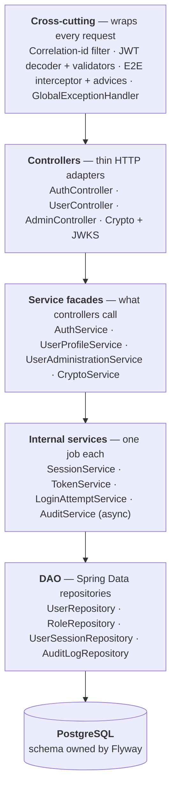
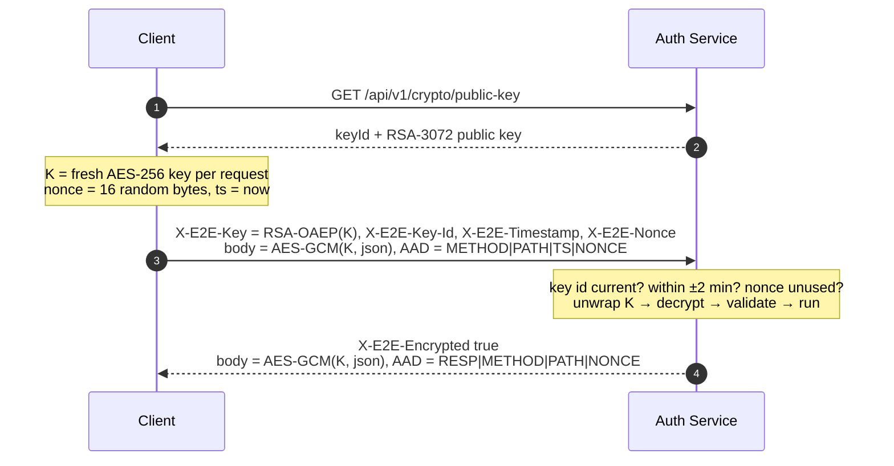
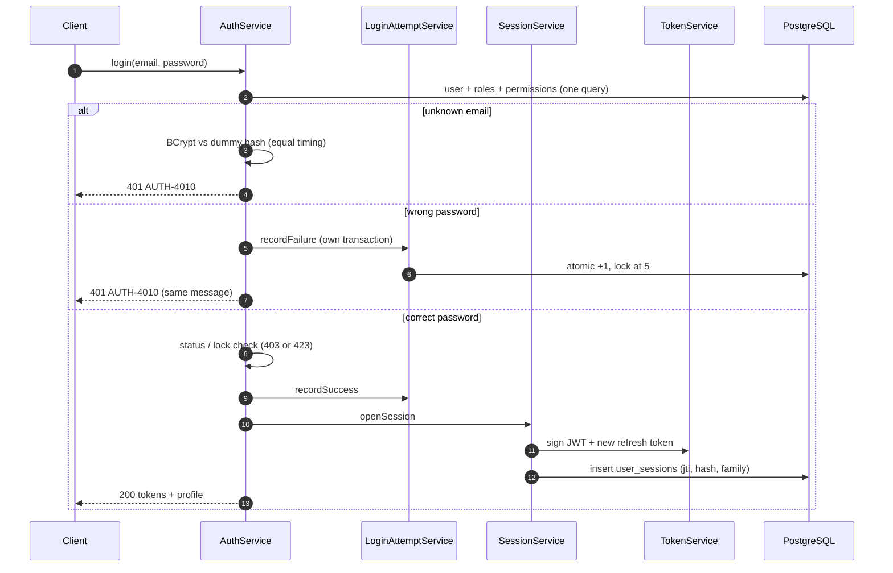
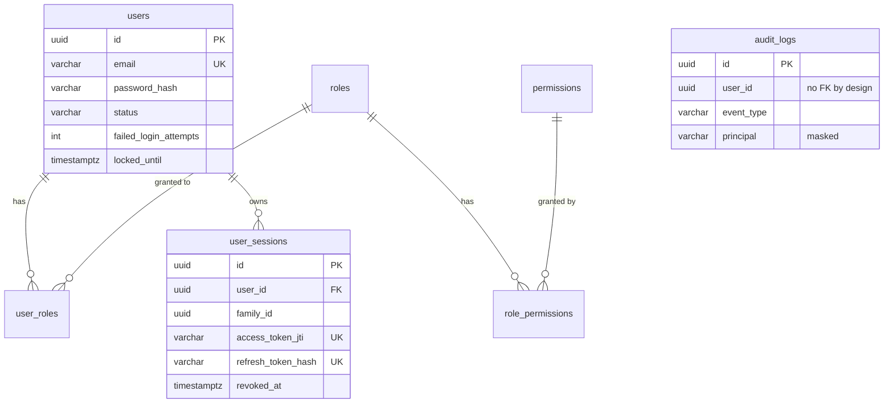

<div align="center">

# EE Security Auth Service

**Enterprise-grade authentication for pay — OAuth2/JWT, role-based access, and end-to-end encrypted payloads.**

[](https://openjdk.org/projects/jdk/21/)
[](https://spring.io/projects/spring-boot)
[](https://spring.io/projects/spring-security)
[](https://www.postgresql.org/)
[](https://flywaydb.org/)
[](https://www.docker.com/)

[Quick start](#quick-start) ·
[Architecture](#architecture) ·
[Security model](#security-model) ·
[Env variables](#environment-variables) ·
[Flows](#how-the-flows-work) ·
[Front end](#front-end-integration) ·
[API](#api-reference) ·
[Testing](#testing) ·
[Troubleshooting](#troubleshooting) ·
[Decisions](#architecture-decisions)

</div>

---

## Overview

This service signs users up, logs them in and out, and issues the tokens every other pay service trusts. It is **its own OAuth2-style token issuer** — no Keycloak, Auth0 or external identity server — and it **encrypts every request and response body end to end**, on top of HTTPS.

<table>
<tr>
<td width="50%" valign="top">

### Identity & access
- **Self-service signup** — every new account is `USER`; admins can't self-register
- **Login** — 15-minute RS256 access token + 7-day refresh token
- **RBAC** — `USER` / `ADMIN` roles with fine-grained permissions
- **Real logout** — tokens revoked server-side, effective on the next request
- **Admin console API** — list users, change status, manage roles

</td>
<td width="50%" valign="top">

### Protection
- **End-to-end encryption** — RSA-OAEP-256 + AES-256-GCM per request
- **Replay protection** — timestamp window + single-use nonce + bound AAD
- **Refresh rotation** — reuse of an old token kills the whole login
- **Brute-force lockout** — 5 failures → 15-minute lock
- **Audit trail** — every security event recorded, PII masked

</td>
</tr>
</table>

### Design principles

| | Principle | In practice |
|:-:|---|---|
| 1 | **Fail closed** | Misconfiguration stops startup with a clear message instead of running insecurely. |
| 2 | **Leak nothing** | Clients get generic error codes; details go to logs only, with personal data masked. |
| 3 | **One job per class** | Each class has a single reason to change, so security logic can be reviewed on its own. |
| 4 | **Prove it at the database** | Counters, revocations and uniqueness use atomic SQL and constraints, not just Java memory. |

---

## Quick start

> [!NOTE]
> Requires **JDK 21**, **Maven 3.9+** and **PostgreSQL 16** (or just Docker).

### Option A — Docker

```bash
docker compose up --build
```

PostgreSQL and the service start together on the `dev` profile at **http://localhost:8080**.

### Option B — IntelliJ / Maven

1. Create database `pay_auth` with user and password `pay_auth`.
2. Keep `spring.profiles.active=dev` in `application.properties`.
3. Run `AuthServiceApplication` or:

```bash
mvn spring-boot:run
```

You should see:

```text
The following 1 profile is active: "dev"
Bootstrap administrator created: ad****@pay.local
Started AuthServiceApplication in ... seconds
```

### Try it

```powershell
curl.exe http://localhost:8080/actuator/health        # {"status":"UP",...}
java tools/E2EClient.java                             # signup → login → /me, fully encrypted
```

> [!TIP]
> Dev admin: `admin@pay.local` / `DevAdmin#Password2026`. Dev keys are in-memory, so tokens reset on every restart.

---

## Architecture

Each layer calls only the one beneath it, always through an interface. Controllers never touch the database, services never parse HTTP, and crypto never leaks into business logic.



**Why layered:** in an auth service one mistake can expose every account. Separating HTTP, rules, persistence and cryptography means each can be reviewed, tested and replaced alone — and a new endpoint can't accidentally return a password hash, because entities never reach controllers.

**Why interfaces everywhere:** callers depend on `AuthService`, not `AuthServiceImpl` (dependency inversion), so implementations swap freely — mocks in tests, an HSM-backed crypto service later.

<details>
<summary><b>Package responsibilities</b></summary>

| Package | Responsibility |
|---|---|
| `controller` | Read the request, call one service method, wrap the result in `ApiResponse`. No business logic. |
| `service` | Interfaces describing what the system can do. |
| `service/impl` | Business rules: credentials, lockout, session rotation, admin rules, audit events. |
| `dao` | Queries, atomic updates, row locks, entity graphs. |
| `entity` | JPA entities with intention-revealing methods and no public setters. |
| `dto` | What crosses the wire. Entities never leave the service layer. |
| `mapper` | The single place that decides what data leaves the service layer. |
| `model` | Internal value objects (`ClientContext`, `IssuedTokens`, `AccessToken`). |
| `security` | Spring Security, JWT, E2E pipeline, key loading, 401/403 writers. |
| `exception` | Domain exceptions and the one handler that turns them into responses. |
| `event` | Audit events and their async listener. |
| `config` | Executors, profile guard, startup failure reporting, admin bootstrap. |
| `constant` | Paths, header names, roles, statuses, error codes. |
| `util` | Stateless helpers: crypto primitives, hashing, masking, request metadata. |

</details>

<details>
<summary><b>Who calls whom</b></summary>

| Caller | Calls | For |
|---|---|---|
| `AuthController` | `AuthService` | signup, login, refresh, logout, logout-all |
| `UserController` | `UserProfileService` | `/me` |
| `AdminController` | `UserAdministrationService` | list, get, status, roles |
| `CryptoController` | `CryptoService` | public key |
| `JwksController` | signing key bean (`RSAKey`) | public JWK Set |
| `AuthService` | `UserRepository`, `RoleRepository` | find and create users |
| `AuthService` | `LoginAttemptService` | count failures, reset on success |
| `AuthService` | `SessionService` | open, rotate, revoke sessions |
| `UserAdministrationService` | `UserRepository`, `RoleRepository`, `SessionService` | change status/roles, then revoke sessions |
| `UserProfileService` | `UserRepository` | load own profile |
| `SessionService` | `TokenService`, `UserSessionRepository`, `UserRepository` | sign JWT, store session, reload user on refresh |
| `LoginAttemptService` | `UserRepository` | atomic counter and lock updates |
| Auth & admin services | `ApplicationEventPublisher` → `AuditEventListener` → `AuditService` → `AuditLogRepository` | audit trail, on a virtual thread |
| `JwtDecoder` via `ActiveSessionTokenValidator` | `SessionService` | is this token's session still active? |
| E2E interceptor + advices | `CryptoService`, `NonceStore` | unwrap key, decrypt, encrypt, replay check |
| Services returning a user | `UserMapper` | entity → `UserResponse` |

</details>

<details>
<summary><b>Project structure</b></summary>

```text
EE-Security-Auth-Service/
├── pom.xml
├── Dockerfile
├── docker-compose.yml              # local: Postgres + app on the dev profile
├── docker-compose.prod.yml         # staging / prod template
├── scripts/
│   └── generate-keys.sh            # creates the PKCS#12 keystore
├── tools/
│   ├── E2EClient.java              # encrypted test client
│   └── pay-Auth-E2E.postman_collection.json
├── docs/
│   ├── adr/ADR-001-token-issuance.md   # why no full OAuth Authorization Server
│   ├── frontend/payAuthClient.ts  # production front-end client (TypeScript)
│   └── e2e-client-example.js       # minimal JS example of the flow
└── src/main/
    ├── java/com/pay/auth/
    │   ├── AuthServiceApplication.java
    │   ├── config/                 # async, scheduling, clock, MVC, profile guard, failure analyzer, admin bootstrap
    │   │   └── properties/         # typed, validated @ConfigurationProperties records
    │   ├── constant/               # ApiPaths, SecurityConstants
    │   │   └── enums/              # RoleName, PermissionName, UserStatus, ErrorCode, AuditEventType, RevocationReason, KeyPurpose
    │   ├── controller/             # Auth, User, Admin, Crypto, Jwks
    │   ├── dao/                    # Spring Data repositories
    │   ├── dto/
    │   │   ├── req/                # validated request records
    │   │   ├── res/                # response records + ApiResponse envelope
    │   │   └── common/             # EncryptedEnvelope (wire format)
    │   ├── entity/                 # JPA entities with domain methods
    │   ├── event/                  # audit events + async listener
    │   ├── exception/              # domain exceptions + GlobalExceptionHandler
    │   ├── mapper/                 # entity → DTO
    │   ├── model/                  # internal value objects
    │   ├── security/               # SecurityConfig, BoundedPasswordEncoder
    │   │   ├── e2e/                # @E2EEncrypted, interceptor, body advices, key resolver, nonce store
    │   │   ├── filter/             # CorrelationIdFilter
    │   │   ├── handler/            # JSON 401 / 403 writers
    │   │   ├── jwt/                # encoder/decoder config, active-session validator
    │   │   └── key/                # KeyProvider: keystore | ephemeral
    │   ├── service/                # interfaces
    │   │   └── impl/               # implementations
    │   └── util/                   # crypto, hashing, masking, request helpers
    └── resources/
        ├── application.properties
        ├── application-{dev,staging,prod}.properties
        ├── META-INF/spring.factories
        └── db/migration/
            ├── V1__init_schema.sql
            └── V2__seed_roles_and_permissions.sql
```

</details>

### Request lifecycle

Every request passes the same ordered stages. Cheap checks run first and any stage can reject before the next runs.

| # | Stage | Job | Rejects with |
|:-:|---|---|---|
| 1 | `CorrelationIdFilter` | Correlation id into logs and `X-Correlation-Id` header | — |
| 2 | Spring Security chain | CORS, security headers, JWT validation, URL rules | 401 / 403 |
| 3 | `DispatcherServlet` | Picks the controller method | 404 / 405 |
| 4 | `E2EEnforcementInterceptor` | Validates `X-E2E-*` headers, unwraps the per-request AES key | `AUTH-4002/4003/4004` |
| 5 | `E2ERequestBodyAdvice` | Decrypts `{iv, data}` into plain JSON | `AUTH-4003` |
| 6 | Jackson + `@Valid` | Binds the request record, rejects unknown fields | `AUTH-4000` |
| 7 | `@PreAuthorize` | Role + permission for this method | `AUTH-4030` |
| 8 | **Controller → Service → DAO** | Business rules, database, audit events | domain codes |
| 9 | `E2EResponseBodyAdvice` | Encrypts the reply (errors too) with the same key | — |
| 10 | Async audit listener | Writes `audit_logs` on a virtual thread | never blocks the reply |

- **Authentication before decryption** — unauthenticated callers can't make the server do RSA work on protected endpoints.
- **Decryption before validation** — validation sees exactly what the client sent; a tampered body never binds to an object.
- **Controllers stay clean** — no crypto, security or error-formatting code.

---

## Security model

### Tokens

| | Access token | Refresh token |
|---|---|---|
| Format | RS256-signed JWT (`eyJ…`) | 256-bit random string |
| Lifetime | 15 minutes | 7 days |
| Stored server-side as | session row keyed by `jti` | **SHA-256 hash only** |
| Sent in | `Authorization: Bearer …` on every call | **only** the body of `/auth/refresh` |
| Contents | `sub` (UUID), `jti`, `iss`, `aud`, `iat`, `nbf`, `exp`, `authorities` | nothing — opaque |

> [!IMPORTANT]
> Never send the refresh token as a Bearer token — it isn't a JWT and is rejected with `AUTH-4011`. Each refresh token works **once**; always store the new one returned by `/refresh`.

The JWT carries **no personal data** — it's signed, not encrypted, so anyone holding it can read it.

### End-to-end payload encryption

HTTPS only protects data as far as the load balancer or API gateway; after that, bodies are plain text in gateway logs, APM tools and proxies. E2E makes bodies readable **only** by the client and this service.



**AAD** (additional authenticated data) is bound into the integrity check without being encrypted — change the method, path, timestamp or nonce and decryption fails.

| Why it's built this way | |
|---|---|
| **Fresh key per request** | No long-lived key to steal; one leaked key exposes one request. |
| **Layered replay protection** | Timestamp bounds *when*, nonce makes it *single-use*, AAD stops redirecting it to another endpoint. |
| **One code for all crypto failures** | `AUTH-4003` everywhere — distinct errors would give attackers an oracle. Only logs show which check failed. |
| **Cheap checks before RSA** | Garbage requests can't make the server burn CPU. |
| **Errors encrypted when possible** | Once a key exists, even error replies are encrypted. Earlier failures (`4002`, `4004`, replays) are plain — there's no key yet. |
| **One annotation** | `@E2EEncrypted` on a controller is all it takes; controllers stay crypto-free. |

<details>
<summary><b>E2E server components</b></summary>

| Component | Job |
|---|---|
| `@E2EEncrypted` | Marks a controller or method as encrypted (auth, user and admin controllers). |
| `E2EEnforcementInterceptor` | Before the controller: if required and enabled, establishes the `E2EContext`. |
| `E2ESessionKeyResolver` | Header checks, key id, ±2 min window, nonce format; unwraps `K`; registers the nonce; builds AAD. Logs missing headers and the caller's user agent. |
| `NonceStore` / `InMemoryNonceStore` | Remembers nonces for 2× the window; repeats rejected. Bounded, cleaned every 30 s. |
| `E2ERequestBodyAdvice` | Decrypts the body before Jackson and `@Valid`. |
| `E2EResponseBodyAdvice` | Encrypts every JSON reply, errors included, when a context exists. |
| `HybridCryptoServiceImpl` + `CryptoUtil` | RSA-OAEP-256 and AES-256-GCM operations (JDK only). |

</details>

### Keys and the issuer

Two **separate** RSA-3072 key pairs — one signs JWTs, one decrypts E2E keys.

| `app.security.keys.source` | Used in | Behaviour |
|---|---|---|
| `ephemeral` | dev | Generated in memory; every restart invalidates all tokens. |
| `keystore` | staging, prod (dev via `KEY_SOURCE=keystore`) | Loads a PKCS#12 file with aliases `jwt-signing` and `payload-encryption`. Refuses to start on wrong path/password, missing or duplicate alias, or keys under 3072 bits. |

```bash
mkdir secrets

keytool -genkeypair -alias jwt-signing        -keyalg RSA -keysize 3072 -validity 365 -dname "CN=auth-jwt" -storetype PKCS12 -keystore secrets/auth-keys.p12 -storepass "<password>" -keypass "<password>"
keytool -genkeypair -alias payload-encryption -keyalg RSA -keysize 3072 -validity 365 -dname "CN=auth-e2e" -storetype PKCS12 -keystore secrets/auth-keys.p12 -storepass "<password>" -keypass "<password>"
```

**The issuer** is just the label in each token's `iss` claim — this service signs its own tokens, so there is no separate JWT server. Use the service's public URL (`http://localhost:8080` in dev, `https://auth.pay.com` in prod). It must be `https://` outside dev and need not serve anything.

**JWKS** — `GET /oauth2/jwks` publishes the public signing key, so any Spring service can validate tokens with no shared secret:

```properties
spring.security.oauth2.resourceserver.jwt.jwk-set-uri=https://auth.pay.com/oauth2/jwks
```

- **RS256, not HMAC** — only this service can sign; with a shared secret, every verifier could forge tokens.
- **Key separation** — compromising or rotating one key doesn't affect the other.
- **`KeyProvider` strategy** — moving to an HSM or cloud KMS is one new class.
- **`kid` = RFC 7638 thumbprint** — two keys can be published side by side during rotation.

---

## How the flows work

<details open>
<summary><b>Signup</b> — <code>POST /api/v1/auth/signup</code></summary>

```json
{ "email": "kayode@test.com", "password": "Str0ng#Password1", "firstName": "Kayode", "lastName": "Ajayi" }
```

1. Normalise the email (trim, lower case).
2. **Hash the password first, outside any transaction** (`BoundedPasswordEncoder` → BCrypt).
3. Short transaction: `existsByEmail` → load `USER` role → `User.register(...)` → `saveAndFlush`.
4. Audit `SIGNUP_SUCCESS` asynchronously → **201** with the profile.

| Why | |
|---|---|
| No `role` field + unknown fields rejected | `"role":"ADMIN"` gets a 400 — privilege escalation is impossible by construction. |
| Hash outside the transaction | BCrypt is ~250 ms of CPU; it never holds one of the 20 pooled connections. |
| Hash before the duplicate check | Taken and new emails take the same time, hindering account probing. |
| DB unique constraint | The final authority when two signups race; the loser also gets 409. |

</details>

<details open>
<summary><b>Login</b> — <code>POST /api/v1/auth/login</code></summary>

```json
{ "email": "admin@pay.local", "password": "DevAdmin#Password2026" }
```



| Why | |
|---|---|
| Same message, same timing | Attackers can't tell which emails have accounts. |
| Status revealed only after the right password | A guesser learns nothing about lock or disabled state. |
| Atomic counters in their own transaction | Concurrent guesses can't race past the limit; the failure still commits. |
| Refresh tokens stored hashed | A database leak exposes no usable tokens. |

</details>

<details>
<summary><b>Calling a protected endpoint</b> — e.g. <code>GET /api/v1/users/me</code></summary>

The `JwtDecoder` checks, in order:

1. **Signature** — RS256 only (blocks `alg: none` and HMAC forgery)
2. **Time** — `exp` not passed, `nbf` reached
3. **Issuer** — matches `app.security.jwt.issuer`
4. **Audience** — contains `app.security.jwt.audience`
5. **Session active** — `jti` exists in `user_sessions` and isn't revoked

Then the URL rule (`/api/v1/admin/**` → `ROLE_ADMIN`) and the method rule (`@PreAuthorize`) apply. The user id always comes from the verified token, never from a URL or body.

| Situation | Status | Code |
|---|:-:|---|
| No token / malformed header | 401 | `AUTH-4012` |
| Bad signature, expired, wrong iss/aud, revoked session | 401 | `AUTH-4011` |
| Valid token, missing role or permission | 403 | `AUTH-4030` |

The session check is what makes logout real — a plain JWT stays valid until expiry. It costs one indexed lookup per request, cheap on virtual threads.

</details>

<details>
<summary><b>Refresh rotation</b> — <code>POST /api/v1/auth/refresh</code></summary>

```json
{ "refreshToken": "FVpF1q3tx93W..." }
```

1. Hash the token and load its session **with a row lock** (`SELECT … FOR UPDATE`).
2. Already `ROTATED` → **replay detected**: revoke the whole token family, audit, 401 (the revocation still commits).
3. Otherwise revoked, expired, or account inactive → 401.
4. Mark it `ROTATED` and issue a new session in the **same family**.

A **token family** is every session created by one login. If a refresh token is stolen, either the thief or the real user is second to use it — that second use reveals the theft and logs both out (OAuth 2.0 Security BCP). The row lock stops two concurrent refreshes both succeeding.

</details>

<details>
<summary><b>Logout & admin operations</b></summary>

- **Logout** revokes the current session (`jti`); other devices stay signed in.
- **Logout everywhere** revokes every active session of the user.

| Admin endpoint | Permission | Effect | Guard rails |
|---|---|---|---|
| `GET /admin/users?page&size` | `USER_READ` | Paged list, newest first | size 1–100, server-side sort |
| `GET /admin/users/{id}` | `USER_READ` | One user | 404 if missing |
| `PATCH /admin/users/{id}/status` | `USER_MANAGE` | Set status; non-active revokes sessions | not your own status |
| `POST /admin/users/{id}/roles` | `ROLE_MANAGE` | Add role, revoke sessions | idempotent |
| `DELETE /admin/users/{id}/roles/{role}` | `ROLE_MANAGE` | Remove role, revoke sessions | not your own `ADMIN`; keep ≥ 1 role |

Permissions live inside the JWT, so every role or status change revokes the user's sessions — a demoted admin loses power immediately, not at expiry.

</details>

---

## Data model



| Role | Permissions |
|---|---|
| `USER` | `PROFILE_READ`, `PROFILE_UPDATE` |
| `ADMIN` | all six — adds `USER_READ`, `USER_MANAGE`, `ROLE_MANAGE`, `AUDIT_READ` |

| Relationship | Why |
|---|---|
| users ↔ roles, many-to-many | A user can hold several roles; a role is shared by many users. |
| roles ↔ permissions, many-to-many | Checks ask for capabilities; a new staff type is a new row, not new code. |
| sessions → users, one direction | `User` has no session list, so loading a user never drags thousands of rows. |
| audit_logs, no FK | Audit evidence must outlive the account and never block its deletion. |
| Lazy everywhere | Login uses one entity-graph query; paging uses batch fetching (no in-memory pagination). |

Every entity extends `BaseEntity` (UUID id, `created_at`, `updated_at`, optimistic-locking `version`) and exposes domain methods like `user.changeStatus(...)` instead of setters. No entity uses Lombok `@Data`/`@ToString`, so a password hash can never be printed by accident.

---

## Configuration

| File | Purpose |
|---|---|
| `application.properties` | Shared settings + `spring.profiles.active=dev` |
| `application-dev.properties` | Local DB defaults, `http://localhost:8080` issuer, ephemeral keys, E2E toggle, relaxed lockout, bootstrap admin, DEBUG logs |
| `application-staging.properties` | Env-driven DB/CORS, keystore, E2E on |
| `application-prod.properties` | Everything from env with **no defaults**, keystore, E2E on, WARN logs |

**Switching environment** — locally, edit `spring.profiles.active`; on servers, set `SPRING_PROFILES_ACTIVE` (it overrides the file).

See [Environment variables](#environment-variables) for every value each environment needs.

### Profile guard & clean startup errors

`ProfileGuardEnvironmentPostProcessor` runs before any bean is created and refuses to start unless **exactly one** of dev / staging / prod is active. In staging and prod it also refuses ephemeral keys, disabled E2E, a non-`https` issuer and localhost / wildcard / `http://` CORS.

Configuration failures are printed by `StartupFailureAnalyzer` as a readable report, not a stack trace:

```text
***************************
APPLICATION FAILED TO START
***************************

Description:
No environment profile is active. Currently active profiles: []

Action:
Set exactly one of dev, staging or prod: ...
```

Both are registered in `src/main/resources/META-INF/spring.factories`:

```properties
org.springframework.boot.env.EnvironmentPostProcessor=com.pay.auth.config.ProfileGuardEnvironmentPostProcessor
org.springframework.boot.diagnostics.FailureAnalyzer=com.pay.auth.config.StartupFailureAnalyzer
```

> [!WARNING]
> `spring.factories` is plain text — **IDE refactoring won't update it**. If you rename the base package, edit it by hand or startup fails with `ClassNotFoundException`.

> [!CAUTION]
> The base file defaults to `dev`. A server started without `SPRING_PROFILES_ACTIVE` runs as dev — throwaway keys and the dev admin password. **Always set it on servers.**

---

## Environment variables

> [!NOTE]
> This section is a guide. The repository does **not** ship a `.env` file — you create your own from the templates below, and it must **never** be committed (`.env` is already in `.gitignore`).

### What they are and why we use them

The properties files never contain secrets or server-specific values. Instead they reference **environment variables** with the syntax `${VARIABLE:default}`:

```properties
spring.datasource.password=${DB_PASSWORD:pay_auth}   # dev: falls back to a local default
spring.datasource.password=${DB_PASSWORD}                 # prod: no default — must be set
```

- In **dev**, every variable has a safe local default, so the app runs with nothing set.
- In **staging/prod**, variables have no defaults, so a missing value **stops startup** instead of silently using something wrong.
- The same jar runs everywhere; only the variables change. Passwords live in the server's environment or secret manager, never in Git.

A **`.env` file** is simply a text file of `KEY=value` lines in the project root that tools (Docker Compose, your shell, IntelliJ plugins) can load as environment variables. It's the recommended way to keep your values in one place.

### Reference

**Legend:** ✅ required · ➖ optional (default shown) · 🔐 secret — never commit

| Variable | What it sets | dev | staging | prod | Example |
|---|---|:-:|:-:|:-:|---|
| `SPRING_PROFILES_ACTIVE` | Which environment runs (overrides `spring.profiles.active`) | ➖ `dev` | ✅ | ✅ | `prod` |
| `SERVER_PORT` | HTTP port | ➖ `8080` | ➖ `8080` | ➖ `8080` | `8080` |
| `DB_URL` | JDBC URL of the PostgreSQL database | ➖ `jdbc:postgresql://localhost:5432/pay_auth` | ✅ | ✅ | `jdbc:postgresql://db.internal:5432/pay_auth` |
| `DB_USERNAME` | Database user | ➖ `pay_auth` | ✅ | ✅ | `pay_auth` |
| `DB_PASSWORD` 🔐 | Database password | ➖ `pay_auth` | ✅ | ✅ | `<strong password>` |
| `DB_POOL_MAX` | Max pooled DB connections | ➖ `20` | ➖ `20` | ➖ `20` | `30` |
| `JWT_ISSUER` | `iss` claim — this service's public URL (`https://` outside dev) | fixed `http://localhost:8080` | ➖ `https://auth-staging.pay.com` | ✅ | `https://auth.pay.com` |
| `JWT_AUDIENCE` | `aud` claim — who tokens are for | fixed `pay-api-dev` | ➖ `pay-api-staging` | ✅ | `pay-api` |
| `CORS_ALLOWED_ORIGINS` | Browser origins allowed to call the API, comma-separated | fixed `localhost:3000/5173` | ✅ | ✅ | `https://app.pay.com` |
| `KEY_SOURCE` | `ephemeral` (in-memory) or `keystore` | ➖ `ephemeral` | fixed `keystore` | fixed `keystore` | `keystore` |
| `KEYSTORE_LOCATION` | Path to the PKCS#12 keystore (`file:` prefix) | with `KEY_SOURCE=keystore` | ➖ `file:/run/secrets/auth-keys.p12` | ➖ same | `file:./secrets/auth-keys.p12` |
| `KEYSTORE_PASSWORD` 🔐 | Password chosen when creating the keystore | with `KEY_SOURCE=keystore` | ✅ | ✅ | `<keystore password>` |
| `PASSWORD_HASH_CONCURRENCY` | Max simultaneous BCrypt hashes (`0` = CPU cores) | ➖ `0` | ➖ `0` | ➖ `0` | `8` |
| `E2E_ENABLED` | Turn payload encryption off for plain-JSON testing | ➖ `true` | not allowed | not allowed | `false` (dev only) |
| `ADMIN_BOOTSTRAP_ENABLED` | Create the first admin at startup | fixed `true` | ➖ `false` | ➖ `false` | `true` (first deploy only) |
| `ADMIN_BOOTSTRAP_EMAIL` | First admin's email | ➖ `admin@pay.local` | ✅ if bootstrap on | ✅ if bootstrap on | `it-admin@pay.com` |
| `ADMIN_BOOTSTRAP_PASSWORD` 🔐 | First admin's password (≥ 16 characters) | ➖ `DevAdmin#Password2026` | ✅ if bootstrap on | ✅ if bootstrap on | `<long random password>` |

"fixed" means the value is hard-set in that profile's properties file and the variable isn't read there.

Two more are read only by `docker-compose.prod.yml`, not by Spring: `AUTH_IMAGE` (image to run, e.g. `pay-auth:1.0.0`) and `KEYSTORE_HOST_PATH` (keystore file on the host, e.g. `./secrets/auth-keys.p12`).

---

### Local machine guide

Work through these in order — each level adds one thing. All values below are **local test values**; never reuse them on a server.

#### Level 1 — Just run it (nothing to set)

The `dev` profile has defaults for everything. You only need PostgreSQL with database, user and password all `pay_auth`:

```powershell
docker compose up -d postgres      # or use your own local PostgreSQL
mvn spring-boot:run
```

You're using: in-memory keys, E2E **on**, admin `admin@pay.local` / `DevAdmin#Password2026`. Test with `java tools/E2EClient.java`.

#### Level 2 — Plain JSON for Postman (one variable)

Turn encryption off so you can send ordinary JSON:

| Variable | Value |
|---|---|
| `E2E_ENABLED` | `false` |

```powershell
# PowerShell
$env:E2E_ENABLED="false"
mvn spring-boot:run
```

```bash
# bash / Git Bash / macOS / Linux
E2E_ENABLED=false mvn spring-boot:run
```

> [!TIP]
> Close the window (or unset it) when you're done so encryption is back on. The encrypted Postman collection in `tools/` works without this.

#### Level 3 — Real keystore in dev (three variables)

Use a real `.p12` file instead of in-memory keys — tokens then survive restarts.

**1. Create a test keystore** (project root):

```bash
mkdir secrets
keytool -genkeypair -alias jwt-signing        -keyalg RSA -keysize 3072 -validity 365 -dname "CN=auth-jwt" -storetype PKCS12 -keystore secrets/auth-keys.p12 -storepass "TestKeystore#2026" -keypass "TestKeystore#2026"
keytool -genkeypair -alias payload-encryption -keyalg RSA -keysize 3072 -validity 365 -dname "CN=auth-e2e" -storetype PKCS12 -keystore secrets/auth-keys.p12 -storepass "TestKeystore#2026" -keypass "TestKeystore#2026"
keytool -list -keystore secrets/auth-keys.p12 -storepass "TestKeystore#2026"    # should list both aliases
```

**2. Set these values:**

| Variable | Value |
|---|---|
| `KEY_SOURCE` | `keystore` |
| `KEYSTORE_LOCATION` | `file:./secrets/auth-keys.p12` |
| `KEYSTORE_PASSWORD` | `TestKeystore#2026` |

**3. Run** and look for `Loaded JWT signing and payload encryption keys from keystore` in the log.

#### Level 4 — Rehearse staging on your laptop (full set)

Runs the real staging rules (keystore required, E2E forced on, `https` issuer, strict CORS) against your local database. This is the best way to catch configuration mistakes before a deploy.

| Variable | Value |
|---|---|
| `SPRING_PROFILES_ACTIVE` | `staging` |
| `DB_URL` | `jdbc:postgresql://localhost:5432/pay_auth` |
| `DB_USERNAME` | `pay_auth` |
| `DB_PASSWORD` | `pay_auth` |
| `JWT_ISSUER` | `https://auth-staging.pay.com` |
| `CORS_ALLOWED_ORIGINS` | `https://app-staging.pay.com` |
| `KEYSTORE_LOCATION` | `file:./secrets/auth-keys.p12` |
| `KEYSTORE_PASSWORD` | `TestKeystore#2026` |

Expect `The following 1 profile is active: "staging"` and the keystore line. Then try breaking it on purpose — set `JWT_ISSUER=http://localhost:8080` and the service should refuse to start with a clear message.

---

### Keeping your values in a local `.env` (recommended)

Typing variables every time gets old. Create a file named **`.env`** in the project root with the values for the level you want, then load it.

**Example — a local `.env` for Level 3 + plain JSON:**

```dotenv
# Local machine only — never commit this file
SPRING_PROFILES_ACTIVE=dev
E2E_ENABLED=false
KEY_SOURCE=keystore
KEYSTORE_LOCATION=file:./secrets/auth-keys.p12
KEYSTORE_PASSWORD=TestKeystore#2026
```

**Example — a local `.env` for Level 4 (staging rehearsal):**

```dotenv
SPRING_PROFILES_ACTIVE=staging
DB_URL=jdbc:postgresql://localhost:5432/pay_auth
DB_USERNAME=pay_auth
DB_PASSWORD=pay_auth
JWT_ISSUER=https://auth-staging.pay.com
CORS_ALLOWED_ORIGINS=https://app-staging.pay.com
KEYSTORE_LOCATION=file:./secrets/auth-keys.p12
KEYSTORE_PASSWORD=TestKeystore#2026
```

**Load it before running:**

<details open>
<summary><b>Windows PowerShell</b></summary>

```powershell
Get-Content .env | Where-Object { $_ -match '^\s*[^#].*=' } | ForEach-Object {
    $name, $value = $_ -split '=', 2
    [Environment]::SetEnvironmentVariable($name.Trim(), $value.Trim(), 'Process')
}
mvn spring-boot:run
```

Variables last until you close that PowerShell window.

</details>

<details>
<summary><b>macOS / Linux / Git Bash</b></summary>

```bash
set -a; source .env; set +a
mvn spring-boot:run
```

</details>

<details>
<summary><b>IntelliJ IDEA</b></summary>

Either install the **EnvFile** plugin and point the run configuration at `.env`, or paste the values into Run → Edit Configurations → `AuthServiceApplication` → **Environment variables**, separated by `;`:

```text
E2E_ENABLED=false;KEY_SOURCE=keystore;KEYSTORE_LOCATION=file:./secrets/auth-keys.p12;KEYSTORE_PASSWORD=TestKeystore#2026
```

</details>

<details>
<summary><b>Docker Compose</b></summary>

Compose reads a `.env` file in the project folder automatically — no extra step.

</details>

**Check it's loaded:** PowerShell `echo $env:KEY_SOURCE` · bash `echo $KEY_SOURCE`.

---

### On a server (staging / prod)

Create a `.env` **on the server** (or put the same keys in your secret manager / Kubernetes `Secret`) using these templates, then run:

```bash
docker compose -f docker-compose.prod.yml --env-file .env up -d
```

<details open>
<summary><b>staging <code>.env</code> template</b></summary>

```dotenv
SPRING_PROFILES_ACTIVE=staging

DB_URL=jdbc:postgresql://<staging-db-host>:5432/pay_auth
DB_USERNAME=pay_auth
DB_PASSWORD=<staging db password>

JWT_ISSUER=https://auth-staging.pay.com
JWT_AUDIENCE=pay-api-staging
CORS_ALLOWED_ORIGINS=https://app-staging.pay.com

KEYSTORE_LOCATION=file:/run/secrets/auth-keys.p12
KEYSTORE_PASSWORD=<staging keystore password>

# First deploy only — then set to false and redeploy
ADMIN_BOOTSTRAP_ENABLED=true
ADMIN_BOOTSTRAP_EMAIL=<admin email>
ADMIN_BOOTSTRAP_PASSWORD=<at least 16 characters>

# Docker compose only
AUTH_IMAGE=pay-auth:latest
KEYSTORE_HOST_PATH=./secrets/auth-keys.p12
```

</details>

<details>
<summary><b>prod <code>.env</code> template</b></summary>

```dotenv
SPRING_PROFILES_ACTIVE=prod

DB_URL=jdbc:postgresql://<prod-db-host>:5432/pay_auth
DB_USERNAME=pay_auth
DB_PASSWORD=<prod db password>
DB_POOL_MAX=20

JWT_ISSUER=https://auth.pay.com
JWT_AUDIENCE=pay-api
CORS_ALLOWED_ORIGINS=https://app.pay.com

KEYSTORE_LOCATION=file:/run/secrets/auth-keys.p12
KEYSTORE_PASSWORD=<prod keystore password>

ADMIN_BOOTSTRAP_ENABLED=false
ADMIN_BOOTSTRAP_EMAIL=
ADMIN_BOOTSTRAP_PASSWORD=

# Docker compose only
AUTH_IMAGE=pay-auth:1.0.0
KEYSTORE_HOST_PATH=./secrets/auth-keys.p12
```

</details>

> [!CAUTION]
> Each environment gets its **own** keystore and passwords. Generate server keystores with a strong password (`scripts/generate-keys.sh`) — never copy your local `TestKeystore#2026` one.

### When a value is missing or wrong

You don't have to guess — startup tells you:

| You forgot… | Startup says |
|---|---|
| `SPRING_PROFILES_ACTIVE` on a server | **no error — it runs as dev.** Always set it. |
| `DB_URL` / `DB_USERNAME` / `DB_PASSWORD` (staging/prod) | `Could not resolve placeholder 'DB_URL'` |
| `JWT_ISSUER` is `http://…` | `Refusing to start: prod requires an https:// JWT issuer` |
| `CORS_ALLOWED_ORIGINS` empty or localhost | `Refusing to start: … requires explicit https:// CORS origins` |
| `KEYSTORE_PASSWORD` wrong | `Unable to load keys from keystore …` with the `keytool -list` command to check |
| `ADMIN_BOOTSTRAP_PASSWORD` under 16 chars | `The bootstrap admin password is shorter than 16 characters` |

---

## Performance

Virtual threads make concurrency cheap; the design protects what's still scarce — **CPU** and **database connections**.

| Decision | Why |
|---|---|
| Virtual thread per request | Waiting on PostgreSQL costs almost nothing. |
| Hikari pool capped at 20, 3 s timeout | With threads unlimited, the pool is the real limit — fail fast, don't queue forever. |
| BCrypt outside transactions | A ~250 ms hash never holds a pooled connection. |
| `BoundedPasswordEncoder` (semaphore = CPU cores) | Login floods get `503 + Retry-After` instead of starving every request. |
| Audit executor, concurrency limit 64 | Audit never delays replies or floods the pool. |
| No `synchronized` in hot paths | Avoids pinning virtual threads on Java 21. |
| `MdcTaskDecorator` | Async audit logs keep the request's correlation id. |

---

## Errors & observability

Every response — success or failure — uses one envelope:

```json
{ "success": false, "code": "AUTH-4010", "message": "Invalid email or password",
  "correlationId": "4aae433f-…", "timestamp": "2026-10-23T16:32:09Z" }
```

Search the server log for the `correlationId` to find the real cause. Messages are deliberately generic; details live only in logs.

<details>
<summary><b>Error codes</b></summary>

| Code | Status | Meaning |
|---|:-:|---|
| `AUTH-4000` | 400 | Validation failed (`errors: [{field, message}]`) |
| `AUTH-4001` | 400 | Malformed request |
| `AUTH-4002` | 400 | Endpoint requires an encrypted payload |
| `AUTH-4003` | 400 | Secure payload rejected (tampered, replayed, bad key) |
| `AUTH-4004` | 400 | Encryption key id stale — refetch the public key |
| `AUTH-4010` | 401 | Invalid email or password |
| `AUTH-4011` | 401 | Invalid or expired token |
| `AUTH-4012` | 401 | Authentication required |
| `AUTH-4030` | 403 | Access denied |
| `AUTH-4031` | 403 | Account not active |
| `AUTH-4032` | 403 | Operation not allowed |
| `AUTH-4040` | 404 | Not found |
| `AUTH-4050` | 405 | Method not allowed |
| `AUTH-4090` | 409 | Registration could not complete |
| `AUTH-4230` | 423 | Account temporarily locked |
| `AUTH-5000` | 500 | Unexpected error |
| `AUTH-5030` | 503 | Service busy — retry |

</details>

**Sensitive data never reaches logs:** DTO `toString()` masks passwords and tokens, emails are masked (`ka****@pay.com`), user agents are sanitised, and `server.error.include-*` is `never`.

**Audit trail:** signup, login success/failure, lockout, logout, refresh, token reuse, status and role changes, and admin bootstrap are written to `audit_logs` asynchronously via Spring events.

---

## Testing

### Java client (encrypted)

```powershell
java tools/E2EClient.java              # signup → login → /me
java tools/E2EClient.java --tamper     # one flipped bit → AUTH-4003 (encrypted reply)
java tools/E2EClient.java --replay     # identical request twice → 2nd gets AUTH-4003
java tools/E2EClient.java http://localhost:8080 kayode@test.com "Str0ng#Password1"
```

Each step prints the plaintext (password masked), the ciphertext actually sent, and the decrypted reply.

### Postman (encrypted)

1. Postman **v11+** (scripts load `node-forge` via `pm.require`).
2. Import `tools/pay-Auth-E2E.postman_collection.json`.
3. Write normal JSON — collection scripts encrypt requests and decrypt responses.
4. Decrypted replies appear in the **Visualize** tab and the **Console**; tokens are saved automatically.

Suggested run: Signup → Login (user) → Me → Admin list *(403)* → Login (admin) → Admin list *(200)* → Refresh → Logout → Me *(401)*.

<details>
<summary><b>More: plain JSON, keystore in dev, unit tests</b></summary>

**Plain JSON (dev only)** — set `app.security.e2e.enabled=false` in `application-dev.properties` and restart. Restore `${E2E_ENABLED:true}` before committing.

**Keystore in dev**

```powershell
$env:KEY_SOURCE="keystore"
$env:KEYSTORE_LOCATION="file:./secrets/auth-keys.p12"
$env:KEYSTORE_PASSWORD="<your password>"
mvn spring-boot:run
```

Expect `Loaded JWT signing and payload encryption keys from keystore`.

**Unit tests** — `mvn test`

| Test | Covers |
|---|---|
| `CryptoUtilTest` | Hybrid round trip, tampering, cross-endpoint replay, bad key length |
| `MaskingUtilTest` | Email masking edge cases |
| `BoundedPasswordEncoderTest` | Load shedding when hashing capacity is full |

</details>

---

## Front-end integration

The server **refuses** unencrypted calls to protected endpoints (`AUTH-4002`), so a front end can't accidentally send plain text — it simply won't work until it encrypts. Use the ready-made client in [`docs/frontend/payAuthClient.ts`](docs/frontend/payAuthClient.ts) (zero dependencies, browser WebCrypto).

### 1. Allow the front end's origin

Add the app's exact origin to `CORS_ALLOWED_ORIGINS` (dev already allows `http://localhost:3000` and `http://localhost:5173`):

```dotenv
CORS_ALLOWED_ORIGINS=https://app.pay.com,https://admin.pay.com
```

The service already allows the `X-E2E-*` request headers and exposes `X-E2E-Encrypted` to browsers.

### 2. Serve the app over HTTPS

WebCrypto only works in a secure context — `https://` or `http://localhost`. On plain `http://` the client throws immediately.

### 3. Use the client

```ts
import { createAuthClient, AuthApiError } from "./payAuthClient";

export const auth = createAuthClient({
  baseUrl: import.meta.env.VITE_AUTH_URL,          // e.g. https://auth.pay.com
  onSessionExpired: () => (window.location.href = "/login"),
});

try {
  await auth.signup({ email, password, firstName, lastName });
  const session = await auth.login({ email, password });   // tokens stored automatically
  const me = await auth.me();                               // encrypted, Bearer added automatically
  const users = await auth.request("GET", "/api/v1/admin/users?page=0&size=20", undefined, { auth: true });
  await auth.logout();
} catch (e) {
  if (e instanceof AuthApiError) {
    // e.code: AUTH-4010, AUTH-4230 …   e.fieldErrors: validation messages   e.correlationId: for support
  }
}
```

What it handles for you:

| Concern | Behaviour |
|---|---|
| Encryption | Fresh AES-256 key + nonce per call; body encrypted, response decrypted and integrity-checked |
| Plain-text fallback | **Rejected** — an unencrypted success response throws `CLIENT-PLAINTEXT` |
| Server key rotation / restart | `AUTH-4004` → refetches the public key and retries once |
| Expired access token | `AUTH-4011` → refreshes once and retries |
| Concurrent refreshes | Single-flight — parallel 401s share one refresh, so one-time refresh tokens are never reused (which would revoke the login) |
| Failed refresh | Clears tokens and calls `onSessionExpired` |

### 4. Verify in the browser

Open DevTools → **Network**, click a call to `/api/v1/auth/login`:

- **Request headers** contain `X-E2E-Key`, `X-E2E-Key-Id`, `X-E2E-Timestamp`, `X-E2E-Nonce`.
- **Payload** is only `{"iv":"…","data":"…"}` — no email or password visible.
- **Response headers** contain `X-E2E-Encrypted: true`, and the response body is `{"iv","data"}`.

If you can read the password anywhere in the Network tab, encryption isn't in use.

### 5. Token storage

The default `memoryTokenStore()` keeps tokens in memory only — the safest option against XSS, at the cost of logging in again after a page reload. If you pass your own `TokenStore` that writes to `localStorage`/`sessionStorage`, any XSS bug can steal the refresh token, so pair it with a strict Content-Security-Policy. (A future option is moving the refresh token into an `HttpOnly` cookie server-side.)

> [!IMPORTANT]
> E2E protects data **between** the browser and the service — through proxies, gateways and logs. It does not protect against malicious code running **in** the page, which can read data before encryption. XSS prevention (CSP, escaping, dependency hygiene) is still essential.

### Mobile apps

Android and iOS clients follow the same five steps as [`tools/E2EClient.java`](tools/E2EClient.java): RSA/ECB/OAEPWithSHA-256AndMGF1Padding (Android) or `SecKeyAlgorithm.rsaEncryptionOAEPSHA256` (iOS) for the key, AES-256-GCM with a 12-byte IV and the same AAD strings for the body.

---

## API reference

Base URL `http://localhost:8080`. Endpoints marked 🔒 are E2E encrypted.

| Method | Endpoint | Access | Body |
|:-:|---|---|---|
| `GET` | `/api/v1/crypto/public-key` | public | — |
| `GET` | `/oauth2/jwks` | public | — |
| `GET` | `/actuator/health` | public | — |
| `POST` | 🔒 `/api/v1/auth/signup` | public | `email`, `password`, `firstName`, `lastName` |
| `POST` | 🔒 `/api/v1/auth/login` | public | `email`, `password` |
| `POST` | 🔒 `/api/v1/auth/refresh` | public | `refreshToken` |
| `POST` | 🔒 `/api/v1/auth/logout` | Bearer | — |
| `POST` | 🔒 `/api/v1/auth/logout-all` | Bearer | — |
| `GET` | 🔒 `/api/v1/users/me` | `PROFILE_READ` | — |
| `GET` | 🔒 `/api/v1/admin/users?page=0&size=20` | `ADMIN` + `USER_READ` | — |
| `GET` | 🔒 `/api/v1/admin/users/{id}` | `ADMIN` + `USER_READ` | — |
| `PATCH` | 🔒 `/api/v1/admin/users/{id}/status` | `ADMIN` + `USER_MANAGE` | `status`, `reason` |
| `POST` | 🔒 `/api/v1/admin/users/{id}/roles` | `ADMIN` + `ROLE_MANAGE` | `role` |
| `DELETE` | 🔒 `/api/v1/admin/users/{id}/roles/{role}` | `ADMIN` + `ROLE_MANAGE` | — |

Encrypted requests carry `X-E2E-Key`, `X-E2E-Key-Id`, `X-E2E-Timestamp`, `X-E2E-Nonce`; encrypted replies carry `X-E2E-Encrypted: true`.

---

## Troubleshooting

| Symptom | Cause | Fix |
|---|---|---|
| `APPLICATION FAILED TO START … No environment profile is active` | `spring.profiles.active` empty | Set `dev`, or `SPRING_PROFILES_ACTIVE` on servers |
| `ClassNotFoundException: …ProfileGuardEnvironmentPostProcessor` | Package renamed, `spring.factories` not | Update both lines in `META-INF/spring.factories` |
| `AUTH-4002` | Plain JSON sent to an encrypted endpoint | Use `E2EClient` / the Postman collection; the log names missing headers and the caller |
| `AUTH-4003` | Tampered, replayed, outside ±2 min, or bad key | Send a fresh request; check the system clock |
| `AUTH-4004` | Server restarted with new keys | Refetch the public key and resend |
| `AUTH-4011` on API calls | Expired, logged out, or **refresh token used as Bearer** | Use the `eyJ…` access token or call `/refresh` |
| `AUTH-4011` on `/refresh` | Token already used, expired or revoked | Log in again |
| `AUTH-4230` | Too many wrong passwords | Wait (dev 1 min, prod 15 min) |
| `AUTH-5030` | Hashing capacity full | Retry after `Retry-After` |
| `ConnectException` in the client | Service not running | Start it; check `/actuator/health` |
| DEBUG logs missing after a rename | Old package in `logging.level.*` | Update to the new package |

---

## Architecture decisions

| ADR | Decision |
|---|---|
| [ADR-001 — Token issuance](docs/adr/README.md) | Self-issued OAuth2-standard JWTs from an encrypted, redirect-free login API, instead of a full OAuth Authorization Server. Lists the assumptions this depends on and when to revisit. |

> [!NOTE]
> **Why not a full OAuth Authorization Server?** Users log in **without redirects** and over **end-to-end encrypted** payloads. OAuth 2.1 has no standard redirect-free user login (the password grant was removed), so Spring Authorization Server would need a custom grant plus custom client authentication — more custom code than today. Tokens are still OAuth2-standard (RS256 JWT + `/oauth2/jwks`) and validated by Spring's OAuth2 Resource Server. See ADR-001 for the full assumptions and revisit triggers.

---

## Design patterns & SOLID

| Pattern | Where | Why it fits |
|---|---|---|
| **Strategy** | `KeyProvider`, `NonceStore` | Swap key / nonce storage per environment without touching callers |
| **Decorator** | `BoundedPasswordEncoder` → `DelegatingPasswordEncoder` → BCrypt | Adds a concurrency cap and algorithm migration around BCrypt |
| **Facade** | `AuthService` | One entry point hides lockout, sessions, tokens and audit |
| **Observer** | `AuthAuditEvent` → `AuditEventListener` | Auditing is decoupled and async |
| **Factory method** | `User.register`, `UserSession.open`, `AuditLog.of` | Objects are always created valid |
| **Chain of responsibility** | Security filter chain, JWT validators | Small, ordered, independently testable checks |
| **Template method** | `TransactionTemplate` | Short transactions only around DB work |
| **Adapter** | Controllers, `UserMapper` | HTTP/DTOs and the domain stay separate |
| **Interceptor + advice** | E2E pipeline | Encryption by one annotation |

- **S** — `TokenService` mints, `SessionService` tracks, `LoginAttemptService` counts, `AuthService` orchestrates.
- **O** — new key storage, nonce storage or roles are new classes or rows, not edits.
- **L** — any `KeyProvider` or `PasswordEncoder` replaces another transparently.
- **I** — `UserProfileService` and `UserAdministrationService` are separate, so user-facing code can't reach admin capabilities.
- **D** — everything depends on interfaces, injected through constructors.

---

## Deployment

```bash
# create .env on the server from the templates in "Environment variables"
./scripts/generate-keys.sh secrets/auth-keys.p12
docker compose -f docker-compose.prod.yml --env-file .env up -d
```

### Production checklist

- [ ] `SPRING_PROFILES_ACTIVE` set explicitly on every staging and prod server
- [ ] Separate keystore per environment, stored with its password in a secret manager
- [ ] Redis-backed `NonceStore` (`SET key NX PX ttl`) before running more than one instance
- [ ] Short-TTL cache in front of `isAccessTokenActive` if per-request lookups show in latency
- [ ] `UPDATE`/`DELETE` revoked on `audit_logs` for the app's DB role; transactional outbox if guaranteed delivery is required
- [ ] Keys moved to an HSM or cloud KMS via a new `KeyProvider`, with a rotation plan
- [ ] Per-IP and per-account rate limiting at the API gateway
- [ ] Email verification before activation, and MFA for admins
- [ ] Scheduled purge of expired `user_sessions` rows
- [ ] Admin bootstrap enabled for the first deploy only, then `ADMIN_BOOTSTRAP_ENABLED=false`

---

<div align="center">
<sub>Built for pay · Java 21 · Spring Boot 3.3 · Secure by default</sub>
</div>